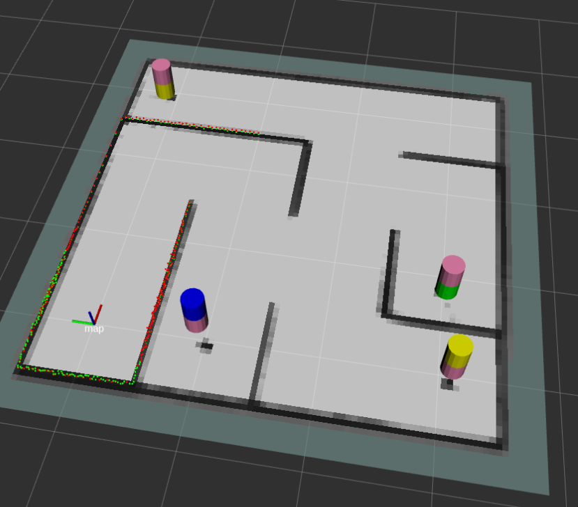
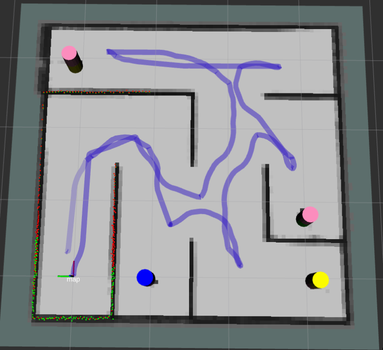
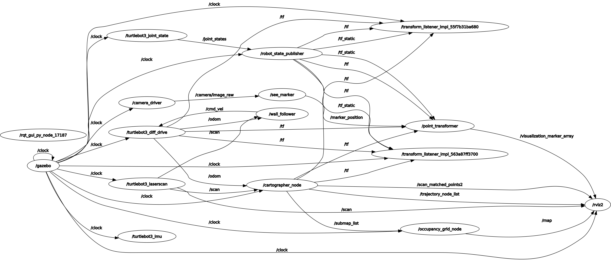

# Recorded validation run

The repository includes evidence from one recorded TurtleBot3 simulation run. This is a reproducibility note, not a statistically significant benchmark.

| Measure | Recorded value |
| --- | ---: |
| Runtime | 232 s |
| Estimated path length | 21.44 m |
| Return-to-start threshold | 0.35 m |
| Final estimated distance to start | 0.33 m |
| Return state | Detected; stop command issued |

The controller log reported `stop=returned_to_start` after the return conditions were armed. Performance will vary with the maze, LiDAR noise, odometry drift, simulation step rate, and controller parameters.

## Visual evidence

